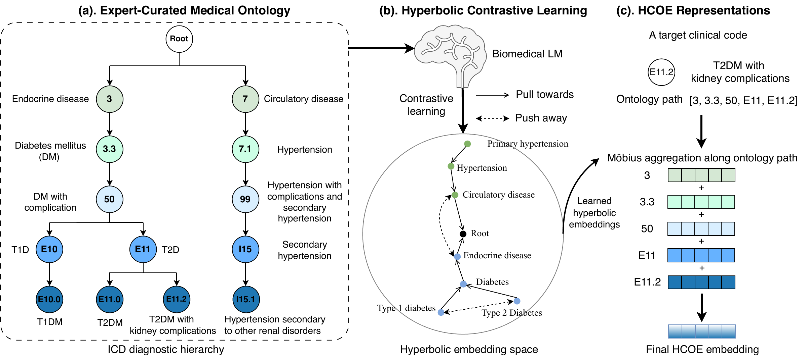

# HCOE

**Hyperbolic Clinical Ontology Embeddings from Biomedical Language Models**

HCOE learns hierarchy-aware clinical concept representations by combining frozen BioBERT embeddings with CCS-organized ICD and ATC ontologies in a Poincaré ball. Its main contributions are integrating biomedical language model semantics with clinical hierarchies, learning parent-child relations through parent-side and child-side hyperbolic contrastive learning, and aggregating embeddings along coarse-to-fine ontology paths using Möbius addition. The paper reports improvements on ICD/ATC relation prediction, CCS-to-PheCode hierarchy transfer, and downstream MIMIC-IV tasks, including mortality prediction, readmission prediction, medication recommendation, and rare drug prediction.

[](figures/HCOE.pdf)

## Using the code

Clone the repository and install the dependencies. The code has been tested with Python 3.13, NumPy 2.1.3, and PyTorch 2.9.1. A CPU is sufficient.

```bash
git clone https://github.com/ZiyangS/HCOE.git
cd HCOE
python3 -m venv .venv
source .venv/bin/activate
python -m pip install -r requirements.txt
```

`method/hcoe.py` implements HCOE, and `method/runtime.py` loads the model and computes relation scores. The checkpoint, precomputed features, ontology nodes, test pairs, and fixed evaluation thresholds are included in `resources/runtime/`, so the four evaluations need no additional data downloads. This release provides inference and ontology evaluation; training and downstream MIMIC-IV pipelines are not included.

To load the clinical concept embeddings in Python, run the following from the repository root:

```python
from method.runtime import load_embeddings

embeddings, curvature = load_embeddings()
print(embeddings.shape)  # (number of ontology nodes, embedding dimension)
```

Row `i` corresponds to the node with ID `i` in `resources/runtime/nodes.json`.

## Running the four experiments

Run these commands from the repository root (`HCOE/`) with the environment above activated:

```bash
# ICD-to-ICD relation prediction (diagnoses and procedures)
python -m experiments.icd_icd

# ATC-to-ATC relation prediction
python -m experiments.atc_atc

# ICD-ATC relation prediction (ATC queries and ICD-9 candidates)
python -m experiments.icd_atc

# CCS-to-PheCode hierarchy transfer
python -m experiments.phecode
```

Each command evaluates the bundled checkpoint on the provided test pairs using fixed thresholds and prints the positive-class F1 score as a percentage.
